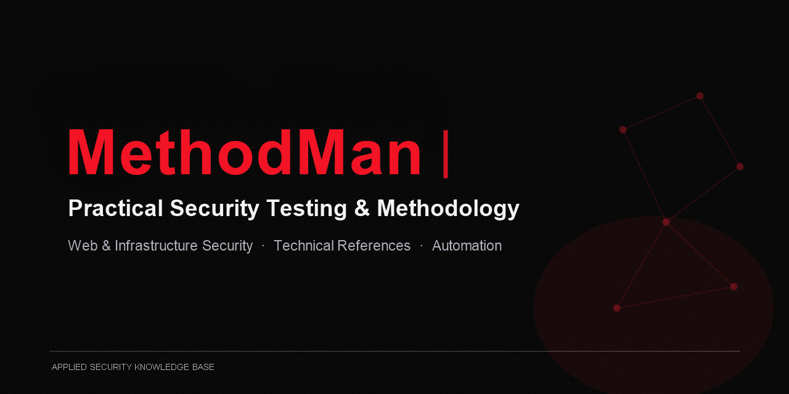

# MethodMan

[](https://github.com/N3xu666/MethodMan/actions/workflows/validate.yml)
[](https://github.com/N3xu666/MethodMan/commits/main)
[](https://github.com/N3xu666/MethodMan)
[](https://creativecommons.org/licenses/by-nc/4.0/)
[](https://opensource.org/licenses/MIT)



New HTB machines are added as they are completed (retired only - see the stub scheme below for active machines). Reference material grows in parallel: the Application Security Reference (`APPLICATIONS/`), the Infrastructure Security Reference (`INFRASTRUCTURE/`), the AI Security Reference (`AI/`), the Anonymity, Privacy and OpSec Reference (`ANONYMITY-PRIVACY-OPSEC/`), the Network Security Reference (`NETWORKS/`), the Cloud Security Reference (`CLOUD/`), methodology notes, cheatsheets, and custom tooling (`tools/`).

Writeups available in Az/En/Ru. Currently: **17 published (retired) + 3 active stubs** = **20 completed machines**.

> The `(Now: M machines)` counter counts **only published walkthroughs** (machines retired on Hack The Box). Writeups for active machines are withheld per HTB ToS and stored as stubs (`Status: Completed`) until retirement.

> [!NOTE]
> All flags, passwords, hashes, and session tokens have been masked for ethical reasons.

---

## Structure

```
MethodMan/
|
+-- WRITEUPS/                                   # HTB walkthroughs, trilingual (Az, En, Ru)
|   +-- 01 Hack The Box/
|       +-- 01 All Machines/
|       |   +-- 01 Season 12 (Aero, Sep - Nov 2026)/
|       +-- 02 OSCP/
|           +-- 01 Linux/
|           +-- 02 Windows/
|           +-- 03 Active Directory and Networks/
|
+-- APPLICATIONS/                               # application security reference
|   +-- 01 Web/
|   +-- 02 Mobile/
|   +-- 03 API/
|
+-- INFRASTRUCTURE/                             # infrastructure security reference
|   +-- 01 Active Directory/
|   +-- 02 Windows Infrastructure/
|   +-- 03 Linux Infrastructure/
|   +-- 04 Network Services/
|   +-- 05 Network Attacks/
|   +-- 06 Wireless/
|   +-- 07 Mail-and-VPN/
|
+-- AI/                                         # AI and LLM security reference
|   +-- 01 OWASP-LLM-Top-10-2026/
|   +-- 02 RAG-and-Embeddings/
|   +-- 03 Agents-and-MCP/
|   +-- 04 AI-Supply-Chain/
|   +-- 05 OSAI-Prep/
|
+-- NETWORKS/                                   # network security reference
|   +-- 01 Network Fundamentals/
|   +-- 02 Routing and Switching/
|   +-- 03 Network Devices/
|   +-- 04 Network Protocols/
|   +-- 05 Traffic Analysis and Forensics/
|   +-- 06 SDN and Modern Networks/
|
+-- ANONYMITY-PRIVACY-OPSEC/                    # anonymity, privacy and OpSec reference
|   +-- 01 Anonymous Networks/
|   +-- 02 Secure Communications/
|   +-- 03 Operating Systems and Hygiene/
|   +-- 04 Dark Web/
|   +-- 05 Anonymous Hosting/
|   +-- 06 Anonymous Crypto Operations and AML/
|   +-- 07 OpSec and Threat Models/
|   +-- 08 Attacks and Detection/
+-- CLOUD/                                      # cloud security reference
|   +-- 01 AWS/
|   +-- 02 Azure/
|   +-- 03 GCP/
|   +-- 04 Kubernetes-Cloud/
|   +-- 05 Serverless/
|   +-- 06 IaC/
|   +-- 02 Secure Communications/
|   +-- 03 Operating Systems and Hygiene/
|   +-- 04 Dark Web/
|   +-- 05 Anonymous Hosting/
|   +-- 06 Anonymous Crypto Operations and AML/
|   +-- 07 OpSec and Threat Models/
|   +-- 08 Attacks and Detection/
|
+-- methodology/                                # OSCP reporting rules and notes
+-- tools/                                      # custom pentest tools (Python, Go, Bash)
+-- tests/                                      # test runner + fixtures for mask.ps1 / check.ps1
```

---

## Contents

| Section | Description | Az | En | Ru |
|---------|-------------|-----|-----|-----|
| [HTB / Season 12 Aero](./WRITEUPS/01%20Hack%20The%20Box/01%20All%20Machines/01%20Season%2012%20%28Aero%2C%20Sep%20-%20Nov%202026%29/) | Special HTB season, Sep - Nov 2026 | [Az](./WRITEUPS/01%20Hack%20The%20Box/01%20All%20Machines/01%20Season%2012%20%28Aero%2C%20Sep%20-%20Nov%202026%29/01%20Az/) | [En](./WRITEUPS/01%20Hack%20The%20Box/01%20All%20Machines/01%20Season%2012%20%28Aero%2C%20Sep%20-%20Nov%202026%29/02%20En/) | [Ru](./WRITEUPS/01%20Hack%20The%20Box/01%20All%20Machines/01%20Season%2012%20%28Aero%2C%20Sep%20-%20Nov%202026%29/03%20Ru/) |
| [HTB / OSCP / Linux](./WRITEUPS/01%20Hack%20The%20Box/02%20OSCP/01%20Linux/) | Linux machines for OSCP prep | [Az](./WRITEUPS/01%20Hack%20The%20Box/02%20OSCP/01%20Linux/01%20Az/) | [En](./WRITEUPS/01%20Hack%20The%20Box/02%20OSCP/01%20Linux/02%20En/) | [Ru](./WRITEUPS/01%20Hack%20The%20Box/02%20OSCP/01%20Linux/03%20Ru/) |
| [HTB / OSCP / Windows](./WRITEUPS/01%20Hack%20The%20Box/02%20OSCP/02%20Windows/) | Windows machines for OSCP prep | [Az](./WRITEUPS/01%20Hack%20The%20Box/02%20OSCP/02%20Windows/01%20Az/) | [En](./WRITEUPS/01%20Hack%20The%20Box/02%20OSCP/02%20Windows/02%20En/) | [Ru](./WRITEUPS/01%20Hack%20The%20Box/02%20OSCP/02%20Windows/03%20Ru/) |
| [HTB / OSCP / Active Directory and Networks](./WRITEUPS/01%20Hack%20The%20Box/02%20OSCP/03%20Active%20Directory%20and%20Networks/) | AD and networks | [Az](./WRITEUPS/01%20Hack%20The%20Box/02%20OSCP/03%20Active%20Directory%20and%20Networks/01%20Az/) | [En](./WRITEUPS/01%20Hack%20The%20Box/02%20OSCP/03%20Active%20Directory%20and%20Networks/02%20En/) | [Ru](./WRITEUPS/01%20Hack%20The%20Box/02%20OSCP/03%20Active%20Directory%20and%20Networks/03%20Ru/) |
| [Web Application Security Reference](./APPLICATIONS/01%20Web/) | Stack-organized web testing reference (recon, frameworks, languages, servers, CMS, technologies, databases, vulnerabilities, OWASP Top 10) | - | [En](./APPLICATIONS/01%20Web/) | - |
| [Mobile Application Security Reference](./APPLICATIONS/02%20Mobile/) | Mobile app security reference (Android, iOS, MASVS, OWASP Mobile Top 10) | - | [En](./APPLICATIONS/02%20Mobile/) | - |
| [API Security Reference](./APPLICATIONS/03%20API/) | API Top 10, REST, GraphQL, gRPC, WebSocket, SOAP, auth, rate-limiting, API gateway (10 files) | - | [En](./APPLICATIONS/03%20API/) | - |
| [Infrastructure Security Reference](./INFRASTRUCTURE/) | Active Directory, Windows, Linux, network services and attacks, wireless, mail and VPN (47 files) | - | [En](./INFRASTRUCTURE/) | - |
| [AI Security Reference](./AI/) | OWASP LLM Top 10, RAG and embeddings, agents and MCP, AI supply chain, OSAI prep (31 files) | - | [En](./AI/) | - |
| [Anonymity, Privacy and OpSec Reference](./ANONYMITY-PRIVACY-OPSEC/) | Tor, I2P, secure communications, Tails/Qubes, dark web, anonymous hosting, crypto/AML, OpSec, attacks and detection (45 files) | - | [En](./ANONYMITY-PRIVACY-OPSEC/) | - |
| [Network Security Reference](./NETWORKS/) | Network fundamentals, routing and switching, network devices, protocols, traffic analysis and forensics, SDN and modern networks (28 files) | - | [En](./NETWORKS/) | - |
| [Cloud Security Reference](./CLOUD/) | AWS, Azure, GCP, Kubernetes in the cloud, serverless, IaC (28 files) | - | [En](./CLOUD/) | - |

### Other Resources

Reference material and tooling, independent of any single HTB machine:

| Resource | Description |
|----------|-------------|
| [Application Security Reference](./APPLICATIONS/01%20Web/) | Web, Mobile and API testing reference: recon, frameworks, languages, servers, CMS, technologies, databases, vulnerabilities, OWASP Top 10 (61 files); plus Mobile app security (Android, iOS, MASVS) and API Top 10, REST, GraphQL, gRPC, WebSocket, SOAP, auth, rate-limiting, API gateway (10 files). |
| [Infrastructure Security Reference](./INFRASTRUCTURE/) | Active Directory, Windows, Linux, network services and attacks, wireless, mail and VPN. Two-track format (offensive + defensive) across 7 subcategories (47 files). |
| [AI Security Reference](./AI/) | OWASP LLM Top 10 (2026), RAG and embeddings, agents and MCP, AI supply chain, OSAI prep. Two-track format (offensive + defensive) across 5 subcategories (31 files). |
| [Anonymity, Privacy and OpSec Reference](./ANONYMITY-PRIVACY-OPSEC/) | Tor, I2P, secure communications, Tails/Qubes, dark web, anonymous hosting, crypto and AML, OpSec and threat models, attacks and detection. 8 subcategories (45 files). |
| [Network Security Reference](./NETWORKS/) | Network fundamentals, routing and switching, network devices, network protocols, traffic analysis and forensics, SDN and modern networks. Two-track format (offensive + defensive) across 6 subcategories (28 files). |
| [Cloud Security Reference](./CLOUD/) | AWS, Azure, GCP, Kubernetes in the cloud, serverless, and infrastructure as code. Two-track format (offensive + defensive) across 6 subcategories (28 files). |
| [METHODOLOGY.md](./METHODOLOGY.md) | Engagement phases, intensity profiles, checklists. |
| [CHEATSHEET.md](./CHEATSHEET.md) | Quick command reference for common tools and techniques. |
| [methodology/OSCP-Reporting.md](./methodology/OSCP-Reporting.md) | OSCP exam reporting rules (evidence, screenshots, structure). |
| [tools/](./tools/) | Custom pentest tools (Python, Go, Bash). First tool: `Session_Report.py` - terminal session recorder. |

**Note:** files marked with `Status: Completed` are **stubs** for machines still active on HTB. Full writeups are published after retirement.

---

## Quality & Automation

Validation is split across three independent layers:

- **Pre-commit hook (`check.ps1`)** - LOCAL only, opt-in. Lives in `.git/hooks/pre-commit`, which is not tracked by git (git does not clone hooks). To install, add a one-line invocation of `check.ps1` to `.git/hooks/pre-commit` and make it executable. Fast (17 checks, ~2 seconds).

  **Blocking errors (commit is refused):**
  - real 32-hex flags,
  - leaks from the local masking dictionary,
  - missing ethical note in a walkthrough,
  - long dashes, broken UTF-8 chars, masking artifacts,
  - unreplaced placeholder markers in docs,
  - backslash-escaped Markdown in docs,
  - chat citation markers `[citation:N]`.

  **Advisory warnings (commit is allowed):**
  - heuristic suspicious passwords,
  - Exploitation section without a CVE reference,
  - broken relative links in docs,
  - counter drift in root README,
  - CVE table rows without a version range,
  - non-etalon References format (markdown-style links or colon-separated URLs instead of the `description - url` etalon).
- **Manual audit (`audit.ps1`)** - LOCAL only, run by the operator before important pushes. Covers git state, tracked files, walkthrough structure, Attack Chain, note placement, flags, dict leaks, dashes, encoding, placeholders, documentation, scripts, hook, origin sync, dynamic machine count, language-pair verification. The full audit is local-only; CI runs `audit.ps1 -SkipLocalChecks` as an informational job.
- **CI (`.github/workflows/validate.yml`)** - runs 8 jobs on every push to any branch and on PRs to `main` (pinned actions, read-only permissions):
  - `check` (windows-latest) - `check.ps1` with a placeholder `masking-dict.ps1` (the real dict is not in git).
  - `test` (windows-latest) - `tests/run-tests.ps1` (masking + check.ps1 leak tests).
  - `tools-syntax` (ubuntu-latest) - `python -m py_compile` on every `.py` under `tools/`.
  - `tools-tests` (ubuntu-latest) - pytest suite in `tools/python/tests/` plus a pip-install smoke test of the `methodman-session-report` package.
  - `gitleaks` (ubuntu-latest) - secret scan over full history with a custom 32-hex flag rule (`.gitleaks.toml`); blocking.
  - `audit` (windows-latest) - `audit.ps1 -SkipLocalChecks` (informational, non-blocking).
  - `anchors` (windows-latest) - `check-anchors.ps1` (informational, non-blocking).
  - `tables` (windows-latest) - `check-tables.ps1` (informational, non-blocking).

The masking pipeline (`mask.ps1` + a local-only `masking-dict.ps1` with known sensitive values) detects and masks flags (32-hex pattern), values listed in the dictionary, and heuristic password shapes. Detection is dictionary- and pattern-based, not exhaustive - manual review remains part of the workflow.

---

## Conventions

- **`01 Az/`** - Azerbaijani writeups.
- **`02 En/`** - English writeups.
- **`03 Ru/`** - Russian writeups.
- Each writeup follows a unified structure: Attack Chain (tree) -> Machine Briefing -> Reconnaissance -> Foothold -> [Authenticated Enumeration (AD only)] -> [Exploitation] -> Lateral Movement -> Privilege Escalation -> Flags -> Key Takeaways. Exploitation sections carry a CVE reference (NVD/MITRE link or "No CVE"); key commands show expected output; OSCP machines include screenshot reminders (`> [!IMPORTANT]`).
- All sensitive data (flags, passwords, hashes) is masked.
- Machines still active on HTB are represented by **stubs** (`Status: Completed`, neutral filename). Full writeups are published after retirement.

---

## License

This repository uses a **dual-license model**:

- **Documentation** (walkthroughs, `APPLICATIONS/`, `INFRASTRUCTURE/`, `AI/`, `ANONYMITY-PRIVACY-OPSEC/`, `NETWORKS/`, `CLOUD/`, `METHODOLOGY.md`, `CHEATSHEET.md`, `README.md`, `SECURITY.md`, and other prose/Markdown content) - [Creative Commons Attribution-NonCommercial 4.0 International (CC BY-NC 4.0)](./LICENSE).
- **Source code** (`.py`, `.go`, `.sh`, `.ps1`, `.yml`) - MIT License, applies to `tools/` and to the root scripts (`check.ps1`, `mask.ps1`, `audit.ps1`, `tests/run-tests.ps1`). Full text: [tools/LICENSE](./tools/LICENSE).

See [LICENSE](./LICENSE) for the full text and the file-type rules.

---

*Personal project. For educational purposes only.*
